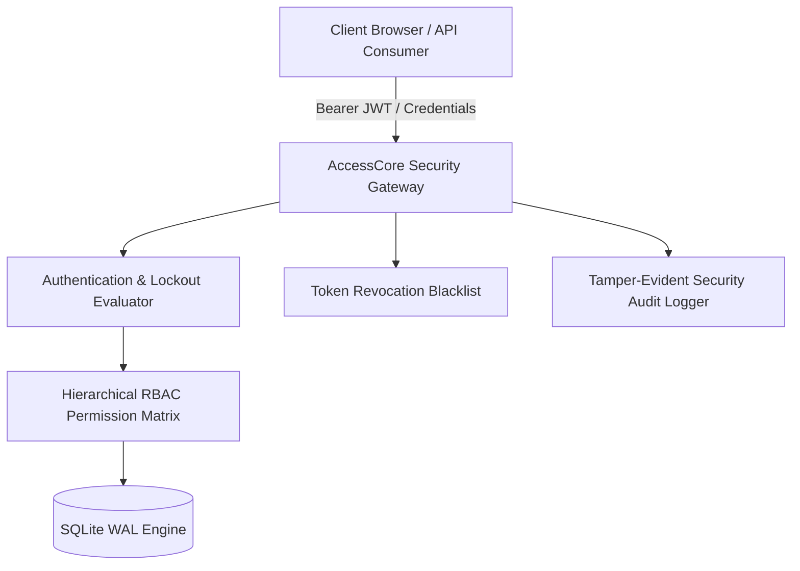

# AccessCore — Enterprise Identity & Role-Based Access Control (IAM) Gateway


AccessCore is a zero-trust enterprise Identity and Access Management (IAM) microservice designed for distributed architectures. It provides multi-tenant role-based access control (RBAC), cryptographically signed HMAC-SHA256 JWT sessions with stateful revocation blacklisting, brute-force exponential lockout protection, and tamper-evident SIEM security audit logging.

---

## Architecture Overview



---

## Core Capabilities

1. **Hierarchical RBAC Engine:** Built-in support for fine-grained permissions (`ADMIN`, `SECURITY_OFFICER`, `AUDITOR`, `MEMBER`) with dynamic assignment and inheritance.
2. **Stateful Session Invalidation:** Cryptographically secure JWT issuing with unique `jti` nonces tracked against a real-time revocation blacklist for instant logout and breach containment.
3. **Brute-Force & Lockout Guard:** Automated tracking of failed authentication attempts with progressive lockout windows to eliminate credential stuffing attacks.
4. **Comprehensive Security Audit Trail:** Structured logging of all authentication events, role modifications, and policy updates with IP tracking.
5. **Zero-Trust Directory Dashboard:** Distinctive dark-terminal administrative console for live identity provisioning, role management, and audit inspection.

---

## Technology Stack

- **Backend:** Python 3.11+, FastAPI, Pydantic v2
- **Database:** SQLite 3 with Write-Ahead Logging (WAL) and strict foreign keys
- **Security:** HMAC-SHA256 tokens, PBKDF2-HMAC-SHA256 password hashing with unique salts
- **Frontend:** Vanilla TypeScript/Modern ES6, Custom CSS Identity Portal
- **Testing:** Pytest, HTTPX Async Client
- **Containerization:** Docker, Docker Compose

---

## Installation & Local Development

### Prerequisites
- Python 3.11+
- Git

### Setup
```bash
# Clone the repository
git clone https://github.com/Soulofghost/accesscore.git
cd accesscore

# Install dependencies
pip install -r requirements.txt

# Run the test suite
pytest backend/tests -v

# Start the development server
uvicorn backend.app.main:app --host 127.0.0.1 --port 8000 --reload
```
Open `http://localhost:8000` in your browser to access the administrative IAM console.

---

## Docker Deployment

```bash
# Build and run with Docker Compose
docker compose up -d --build

# View container logs
docker compose logs -f
```

---

## API Reference

| Method | Endpoint | Description | Auth Required |
|--------|----------|-------------|---------------|
| `GET` | `/api/health` | Service health and version status | No |
| `POST` | `/api/auth/register` | Provision new corporate identity | No |
| `POST` | `/api/auth/login` | Authenticate identity and generate JWT session | No |
| `POST` | `/api/auth/verify-token` | Validate JWT claims and check blacklist status | Yes |
| `POST` | `/api/auth/logout` | Revoke session and add `jti` to blacklist | Yes |
| `GET` | `/api/users` | List all provisioned identities and role states | Yes |
| `POST` | `/api/users/{id}/roles` | Assign or update hierarchical roles for a user | Yes (`ADMIN`) |
| `GET` | `/api/roles` | Inspect available system roles and capabilities | Yes |
| `GET` | `/api/audit-logs` | Retrieve chronological security audit trail | Yes (`AUDITOR`) |

---

## License

SPDX-License-Identifier: MIT  
Copyright (c) 2026 Alvin MS ([@Soulofghost](https://github.com/Soulofghost)).
